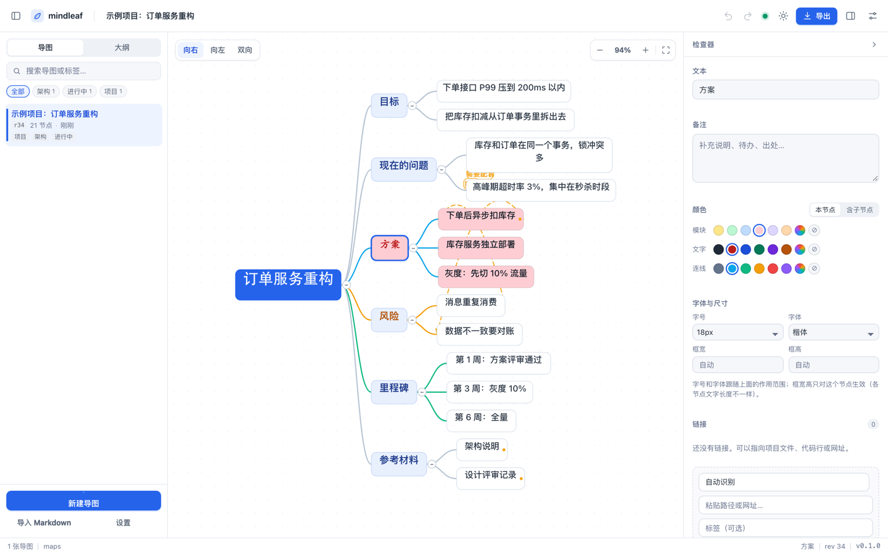
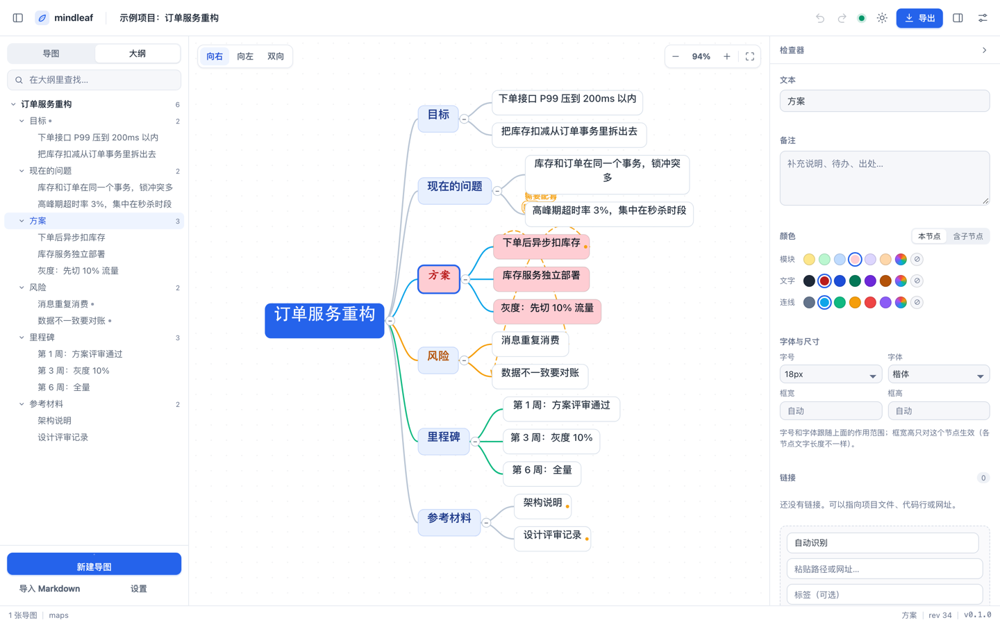
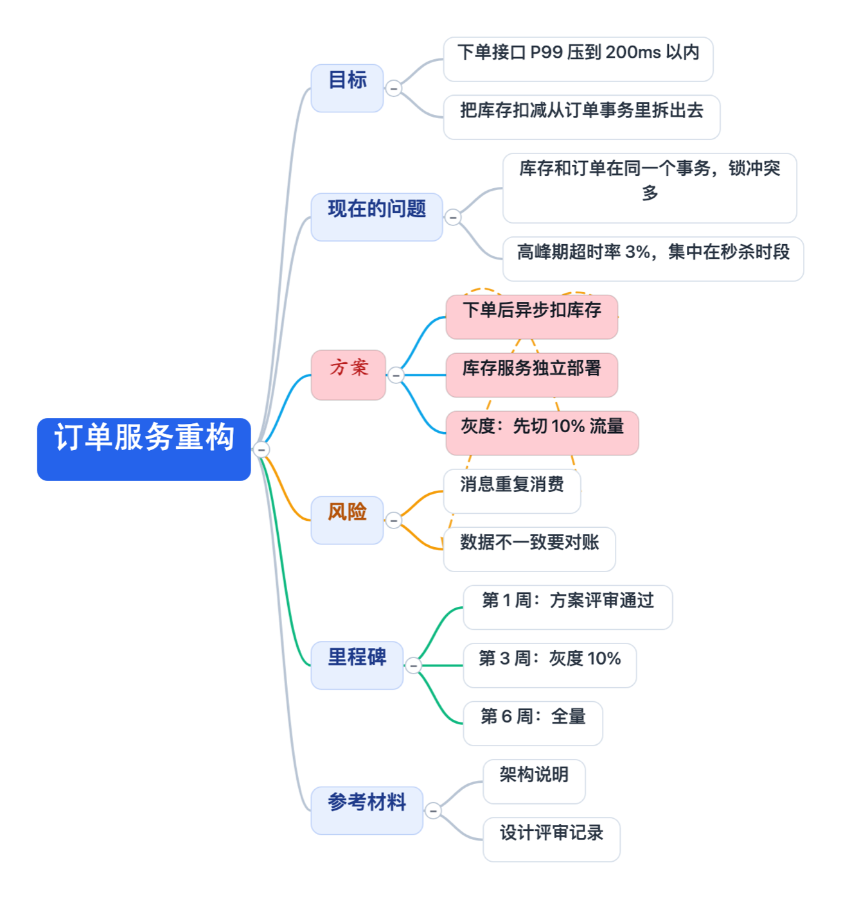
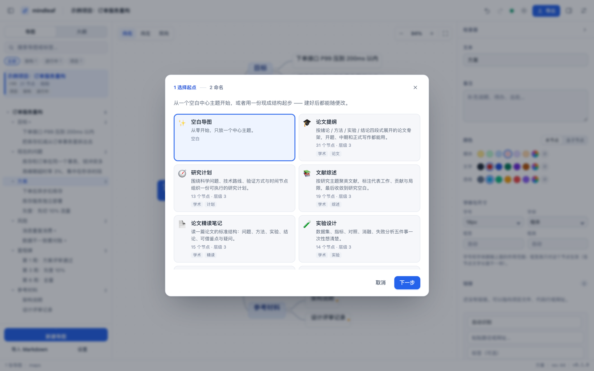
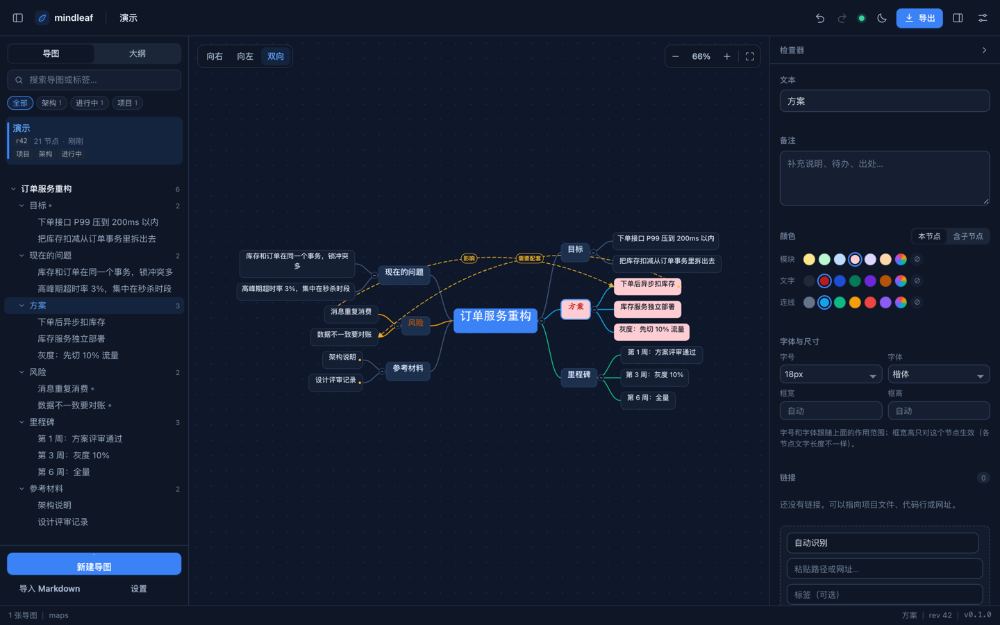

English | [简体中文](README.md)

# Mindleaf

> Still adding nodes to your mind map one at a time?
> Still asking an AI for a mermaid block, pasting it back, fixing the indentation, and starting over
> because the Chinese came out misaligned?
> We have AI now. Come on.

Papers, projects, breaking a task down — whenever something gets complicated my head turns into a mess.
So I sketch a tree first, spread the points out, and fill in the details afterwards.

Then I went looking for a mind map tool an AI could actually work with, and there wasn't one. Which is
how the last few months went:

- Adding nodes by hand. By node thirty I'd forgotten what node ten said.
- Asking an AI to generate the diagram. Great until I needed a change: moving one level meant
  redrawing everything, Chinese text kept drifting out of place, and somehow I'd become the person
  proofreading the AI's layout.
- Finally exporting a PNG to send somewhere. When I wanted a change later, the PNG was all I had left.

So I wrote this with DSH. The idea fits in one line:

> **A map is a JSON file. You drag nodes in the browser, the AI edits them through MCP tools, and both
> are working on the same copy.**

Move a node and the AI knows you touched it next time it reads (who, when, and what changed are all
recorded). Let the AI change a batch and your open browser says "modified externally, click to
refresh" instead of overwriting whatever you were typing. No more "the AI produced a new version, now
I copy-paste it in".



# Running it

**Node.js 20 or newer**, no dependencies to install. Three ways in:

**1. npm (the short path)**

```bash
npm i -g mindleaf
mm serve --open
```

You get `mindleaf` and the short alias `mm`. Without installing: `npx mindleaf serve --open`.

**2. Clone the full repo (if you want to read or change the code)**

```bash
git clone https://github.com/SKeng-Cheng/mindleaf.git
cd mindleaf
node bin/mindleaf.mjs serve --open
```

**3. Clone only the minimal package (if you just want to use it)**

`main` is the complete version: 67 files, 2.6 MB unpacked (2.1 MB as a zip), tests, screenshots and dev
docs included. `lite` is the minimal package that implements the functionality: 44 files, 437 KB
unpacked (146 KB as a zip), only the code and templates needed to run it.

```bash
git clone -b lite --depth 1 https://github.com/SKeng-Cheng/mindleaf.git
cd mindleaf && node bin/mindleaf.mjs serve --open
```

On macOS you can also double-click `启动 Mindleaf.command`; it starts the server and opens a browser.

## First run

```bash
mm serve --open                               # start the web app (port 7788, auto-increments if busy)
mm new "Project plan" --template project-roadmap
mm export "Project plan" -f png
```

The first run creates three things in the current directory:

```
project/
├── mindleaf.json   # config: where maps and exports live (auto-created, not committed)
├── maps/           # your maps, plain JSON
└── exports/        # exported images and PDFs
```

**Move the maps somewhere else**: Settings → Maps directory in the web UI, or
`mm config --maps-dir ~/Documents/maps` — it's remembered, and the AI reads the new location too.

# Features

## 1. Edit the map in the browser

Map list on the left, canvas in the middle, properties of the selected node on the right. Scroll to
zoom, drag empty space to pan, double-click empty space to recentre.

You don't need menus to add nodes — the keyboard is enough:

| Action | Shortcut |
| --- | --- |
| New map | `⌘/Ctrl + N` |
| Add child / sibling | `Tab` / `Enter` |
| Edit the selected node | `F2`, or double-click |
| Delete node (with its subtree) | `Delete` |
| Move up / down among siblings | `↑` / `↓` |
| Go to parent / first child | `←` / `→` |
| Collapse / expand | `Space` |
| Undo / redo | `⌘/Ctrl + Z` / `⇧⌘Z` |
| Reparent | drag the node onto another node |
| Sidebar: maps / outline | `⌘/Ctrl + 1` / `⌘/Ctrl + 2` |

After `Tab` you're already typing — no extra click into a text field. Keep going `Tab`, `Enter`, `Tab`
and the diagram builds itself as you think. Typed something wrong? `⌘Z`.

Nodes can be collapsed so a big map shows only its skeleton, and the version history lets you go back
if you break something.

### Node style

The right panel, top to bottom: text, note, colours, font and size, links, structure.

Three colours: **box** (the node's fill), **text** (the font colour), **line** (the connector coming
into this node; children inherit it automatically). Each row has six presets, a custom colour picker
and a clear button.

Font size, font and box size live in the same block:

| Field | Notes |
| --- | --- |
| Font size | Auto, or 12 / 13 / 14 / 15 / 16 / 18 / 20 / 22 / 24 / 28 / 32 |
| Font | System default, Hei, Song, Kai, Mono, Western serif — all system fonts, nothing downloaded |
| Box width / height | Empty means auto; a width fixes the wrap width, a height is a minimum (the box grows if the text needs it) |

The "本节点 / 含子节点" switch at the top right of the colour block sets the scope:

- **本节点 (this node)**: only the selected node
- **含子节点 (with children)**: the node and every descendant (colours, size and font; box size stays
  single-node because text lengths differ)

## 2. Edit the same map as an AI

This is the main reason the tool exists.

Once MCP is connected, the AI has 18 tools. The usual sequence is:

```
read_map  →  apply_ops  →  export_map
get ids     change several things at once    export
```

Most AI drawing flows go: you describe it, the AI emits some code or an image, you paste it somewhere,
and if you want changes you start over. By round three the AI no longer knows what the document
actually looks like. Here it reads the current structure from the file every time — the order you
adjusted by hand this morning, the note you added, the heading you renamed are all there when it picks
the work up in the afternoon.

It can also tell who did what: every change is recorded with `user` / `agent` / `cli` and a short
summary, and `recent_changes` tells the AI which nodes you just touched.

And you won't get overwritten: when the AI writes, your open page says "modified externally" — it
merges silently if you're idle, and waits for you to click if you're typing.

## 3. Tags: sort the maps, find them fast

Once you have more than a handful of maps, a flat list stops working. So each map can carry a few
tags. The top of the sidebar lists every tag with its count — click one to see just that group.

Edit tags right in the map list (hover an item, click the tag icon) or while creating a map. The
search box matches titles, file names and tags, so remembering one word is enough.

```bash
mm tag "Project plan" --add work,in-progress     # add tags
mm tag "Project plan" --remove in-progress       # remove one
mm tag "Project plan"                            # show current tags
mm list --tag work                               # only maps with that tag
```

## 4. Outline sidebar: see the whole structure

The canvas is for working on details. To read the shape of a big map, an indented list is faster.
Switch the sidebar to "大纲" (outline) and you get exactly that:



- Click a row and the matching node is selected and scrolled into view;
- Rows with children have an arrow, so you can collapse them without going back to the canvas;
- A small dot marks nodes that have a note;
- The search box filters the outline, expanding just the branches that match.

## 5. Nodes can link to files, URLs, and code

| Kind | How to write it | What opens |
| --- | --- | --- |
| File | `docs/architecture.md` (relative path) | previewed in a drawer on the right |
| URL | `https://example.com` | a new browser tab |
| Code | `src/order/service.ts#L120-L180` | preview with line numbers, range highlighted |

Relative paths start from `workspaceDir` in `mindleaf.json` (default: the project directory). There's
also a "show in Finder" button (Explorer on Windows) next to the preview.



## 6. Ten templates that are actually useful

When creating a map you can start from a template. There are ones for papers, and ones for projects,
meetings and weekly planning:

| Template | What it's for |
| --- | --- |
| Thesis outline | Introduction / method / experiments / conclusion skeleton |
| Research plan | Question, approach, how to validate, timeline |
| Literature review | Group papers by theme, narrow down to the gap |
| Paper notes | A fixed set of questions for reading a paper |
| Experiment design | Datasets, metrics, baselines, ablations, failure analysis |
| Project roadmap | Milestones, deliverables, risks |
| Meeting notes | Agenda, decisions, todos, owners |
| Weekly plan | Goals, tasks, blockers, review |
| SWOT analysis | Four quadrants plus strategy |
| Knowledge map | A learning path and a reading list |



Templates are Markdown files under `templates/`: heading levels become the tree, list items become node
notes. To add one, drop a `.md` file in.

## 7. Export: PNG / JPG / PDF / SVG / Markdown / JSON / HTML

```bash
mm export "Project plan" -f pdf              # writes to exports/
mm export "Project plan" -f png --scale 2 -o ~/Desktop/plan.png
```


| Format | When to use it |
| --- | --- |
| `png` / `jpg` | Sending to someone, pasting into slides (drawn in the browser, 2× resolution) |
| `pdf` | Printing, attaching to a document. Vector text with Chrome or Edge, so Chinese can be selected |
| `svg` | Embedding in a page, LaTeX or slides; stays sharp, nodes keep their hyperlinks |
| `md` | Handing an outline to another tool; imports back too |
| `json` | Backup, migration |
| `html` | One file, double-click to view, all styles inlined |

`mm doctor` reports what's available on this machine. If nothing is, PNG and JPG export still work —
the in-browser one is drawn by the browser.

## 8. Dark mode, narrow windows, and small things

<p align="center">
  
  
</p>

Left is the dark theme with the "grow both ways" layout; right is the window squeezed down to phone
width, where the sidebar and the panel become overlays and the canvas takes the whole width.

Three layouts: grow right, grow left, or split both ways. Switching recentres and rescales automatically.

# Command line

For when you don't want a browser, or want to script it. Every command accepts `--project <dir>`;
without it, the tool walks up looking for `mindleaf.json`.

| Command | What it does |
| --- | --- |
| `mm serve [--port 7788] [--open]` | Start the web app |
| `mm open [map]` | Start it and open a specific map |
| `mm list [--tag tag]` | List maps, optionally filtered by tag |
| `mm show <map> [--json\|--md]` | Show a map (outline with node ids by default) |
| `mm new <title> [--template id] [--tags a,b]` | Create a map |
| `mm add <map> <text> [--parent node]` | Add a node; parent can be an id or its text |
| `mm set <map> <node> ...` | Edit a node: `--text` `--note` `--color` `--text-color` `--line-color` `--font-size` `--font` `--width` `--height` `--link` `--parent` `--subtree` |
| `mm rm <map> <node>` | Delete a node and its subtree |
| `mm mv <map> <node> <new parent>` | Move a node |
| `mm edge <map> <from> <to> [--label]` | Add a cross-branch relation |
| `mm tag <map> [--add a,b] [--remove c] [--set x,y] [--clear]` | Manage tags |
| `mm import <map\|new> <file.md>` | Import a Markdown outline |
| `mm export <map> -f png\|jpg\|pdf\|svg\|md\|json\|html` | Export |
| `mm log <map> [--since rev]` | Who changed what, and when |
| `mm rollback <map> --rev 3` | Roll back to a revision |
| `mm templates` / `mm fonts` | List templates / available fonts |
| `mm doctor` | Check the environment and export backends |
| `mm config [--maps-dir path]` | Show or change project config |

A few examples:

```bash
mm new "My Thesis" --template thesis-outline --tags paper,in-progress
mm add "My Thesis" "3.1 Problem definition" --parent "Chapter 3"
mm set "My Thesis" "Chapter 3" --color "#fecdd3" --font-size 18 --subtree
mm set "My Thesis" "Chapter 3" --width 220 --height 90
mm export "My Thesis" -f png --scale 2
mm import new outline.md
mm log "My Thesis"
```

`mm <command> --help` has the full list.

# Connecting an AI

MCP over standard stdio. DSH, Codex, Claude Code and Claude Desktop all work:

```bash
node bin/mindleaf.mjs mcp --project "/path/to/project"
```

The 18 tools on the agent side: `list_maps` `list_tags` `list_fonts` `list_templates` `create_map`
`read_map` `add_node` `update_node` `remove_node` `move_node` `apply_ops` `add_edge` `update_map`
`export_map` `import_markdown` `recent_changes` `open_in_browser` `doctor`.

The config can be written for you, or just printed so you can paste it:

```bash
node integrations/install.mjs --check        # see which clients are already set up
node integrations/install.mjs                # print every snippet, touch nothing
node integrations/install.mjs --apply        # actually write (backs up first)
node integrations/install.mjs --target dsh   # build the DSH plugin bundle
```

## DeepSeek Harness

```bash
node integrations/install.mjs --target dsh
```

Then pick `integrations/.rendered/dsh/mindleaf-mcp` under Plugins → Add plugin. In a new session the
tools appear with a `mindleaf__` prefix, e.g. `mindleaf__read_map`.

## Codex CLI

Edit `~/.codex/config.toml`:

```toml
[mcp_servers.mindleaf]
command = "/absolute/path/to/node"
args = ["/path/to/mindleaf/bin/mindleaf.mjs", "mcp", "--project", "/path/to/project"]
cwd = "/path/to/project"
startup_timeout_sec = 20
tool_timeout_sec = 120

[mcp_servers.mindleaf.env]
PATH = "/absolute/path/to/node-dir:/usr/local/bin:/usr/bin:/bin"
```

`codex mcp add` works too, it just has no `cwd` option, so editing the TOML is simpler.

## Claude Code

Put this in `.mcp.json` at the project root. The first time you'll need to approve it in `/mcp`:

```json
{
  "mcpServers": {
    "mindleaf": {
      "type": "stdio",
      "command": "/absolute/path/to/node",
      "args": ["/path/to/mindleaf/bin/mindleaf.mjs", "mcp", "--project", "/path/to/project"],
      "env": { "PATH": "/absolute/path/to/node-dir:/usr/local/bin:/usr/bin:/bin" }
    }
  }
}
```

## Claude Desktop

Edit `~/Library/Application Support/Claude/claude_desktop_config.json`. Leave the existing
`preferences` alone and only add `mcpServers`. It doesn't reload live, so quit it fully and start again.

## Two pitfalls, up front

Apps launched from an icon don't usually have nvm's node on `PATH`, and their working directory is
often `/`. So always put the absolute path to node in the config, and pass `--project` to say where the
project is.

And stdout carries JSON-RPC only — a single `console.log` in the server makes the host drop the
connection. All logging goes to stderr.

The instructions written for the agent live in [AGENTS.md](AGENTS.md). Codex reads it automatically;
Claude Code reads `CLAUDE.md`, which points at it.

# Data and backups

```
project/
├── mindleaf.json          # project config (created on first run, not committed)
├── maps/
│   ├── Project plan.mindmap.json
│   └── .history/<slug>/   # the last 30 versions
└── exports/
```

- **Maps are plain JSON.** To version them with git, delete the `/maps/` line in `.gitignore`.
- Every write bumps `rev` and appends to the journal (who, when, what) — see `mm log`.
- Break something? `mm rollback <map> --rev N`, or use the history list in the web UI.
- Moving machines: copy `mindleaf.json` + `maps/`. No database, no hidden state.

## The file format

```jsonc
{
  "format": "mindmap", "schemaVersion": 1, "rev": 2,
  "title": "Project plan",
  "tags": ["work", "in-progress"],
  "settings": { "layout": "right", "theme": "light" },
  "nodes": [
    { "id": "root", "parent": null, "text": "Project plan", "order": 0, "collapsed": false, "note": "", "links": [] },
    { "id": "n_1", "parent": "root", "text": "Step 1: survey the current state", "order": 0,
      "color": "#fecdd3", "textColor": "#b91c1c", "lineColor": "#0ea5e9",
      "fontSize": 18, "font": "kai", "boxWidth": 220,
      "links": [{ "kind": "file", "target": "docs/architecture.md", "label": "Architecture" }] }
  ],
  "edges": [{ "id": "e_1", "from": "n_1", "to": "n_2", "label": "related" }],
  "journal": [{ "rev": 2, "at": "…", "by": "agent", "action": "ops", "summary": "added 3 nodes" }]
}
```

In short: nodes sit flat in one array and point at their parent, `rev` goes up by one on every write,
`journal` records each change, and `tags` are the map's labels. A complete example is
[examples/demo.mindmap.json](examples/demo.mindmap.json).

# Project layout

No dependencies: Node standard library only, the web UI is plain JavaScript with no build step, and the
AI side speaks MCP over stdio. `mindleaf.json` and `maps/` are local config and data — both are in
`.gitignore`, so they never travel with the repo.

```bash
bin/mindleaf.mjs        entry point: serve / mcp / the various subcommands
src/core/               document model, operations, Markdown conversion, layout, SVG rendering
src/export/             export: images, PDF, the other formats
src/server/             HTTP server and local storage
src/mcp/                MCP server
web/                    the web UI (index.html / app.js / style.css)
templates/              built-in templates (Markdown, easy to add your own)
tests/                  tests
integrations/           per-client AI setup and the one-shot install script
examples/               a sample map
```

# FAQ

**Port already in use?** `mm serve --port 7800`; without a port it picks the next free one.

**`command not found: mm`?** npm's global bin directory is probably not on `PATH` — check
`npm prefix -g`.

**Chinese isn't selectable in the exported PDF?** That means no Chrome/Edge was found, so the PDF fell
back to a full-page image (readable and printable, but the text can't be selected). Install a
Chromium-based browser and export again for vector text.

**When does another agent see my changes?** Immediately — every write bumps `rev` and notifies open
pages.

**Can two people edit at once?** Not live. The scope is one machine, one directory; use git for
collaboration.

**Only want to remove the tool and keep the maps?** Delete the code directory; `maps/` holds standalone
JSON files.

**Safari / Firefox?** Haven't tried them; only Chrome and Edge.

**How do I uninstall?** `npm uninstall -g mindleaf`, or delete the cloned directory. Your maps in
`maps/` are untouched.

# Known issues

- Vector PDF needs Chrome or Edge on the machine. Without one, Chinese PDFs are images: usable, but the
  text can't be selected.
- Maps over about a thousand nodes get slow on the first render. A few-hundred-node map feels fine.
- Collaboration means one machine and one directory. For several people, use git.
- Only Chrome and Edge have been used. Safari and Firefox haven't been tried.

# Platform support

I've only ever used this on macOS. Linux and Windows have never been run, so I honestly can't say
whether they'll cause problems.

The code does have per-platform paths in it (Chrome / Edge install locations, `xdg-open` and `explorer`
for opening a browser), but none of it has actually been run. If it works for you somewhere else — or
breaks — an issue is welcome.

# License

[MIT](LICENSE) © 2026 SKeng-Cheng

---

Rough around the edges, but I use it every day. If you end up drawing these trees all the time too, I
hope it saves you some time.
