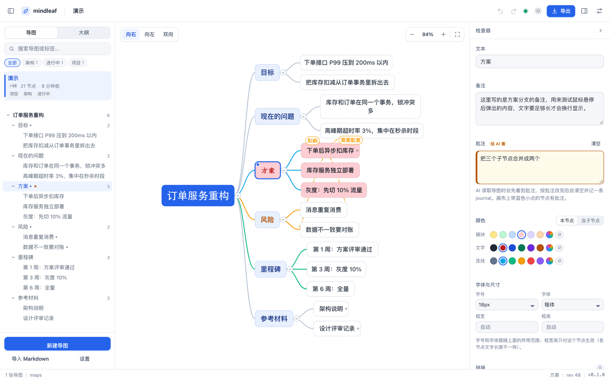
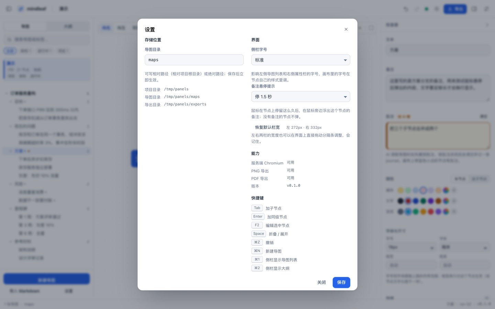
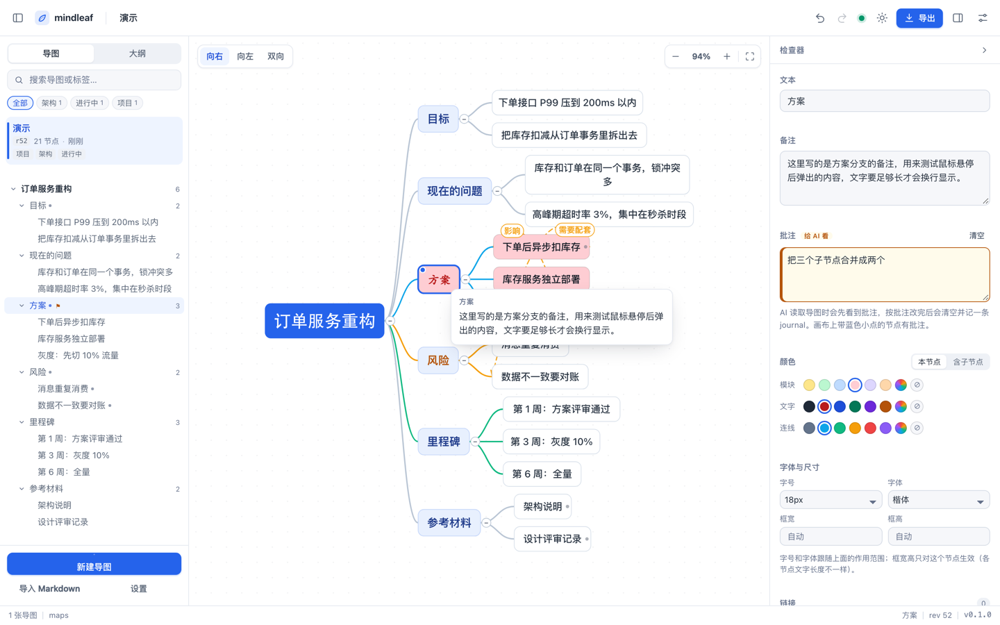
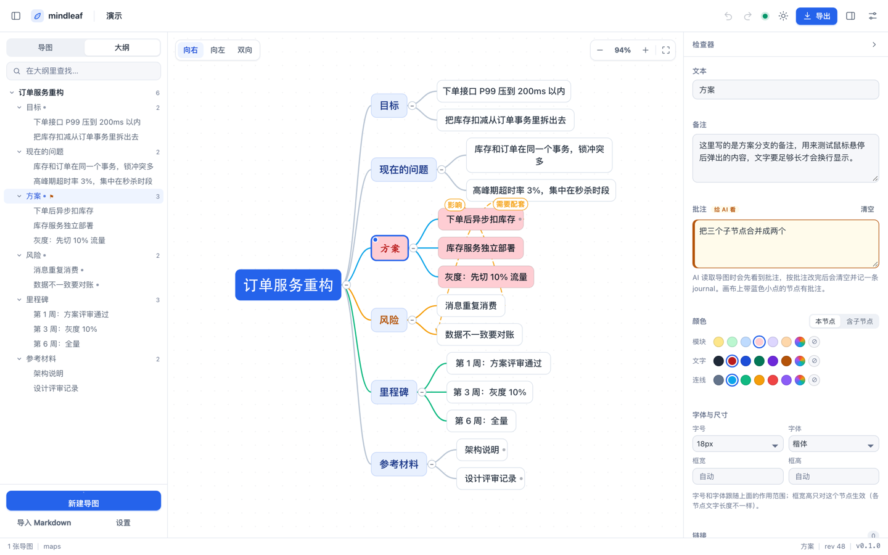
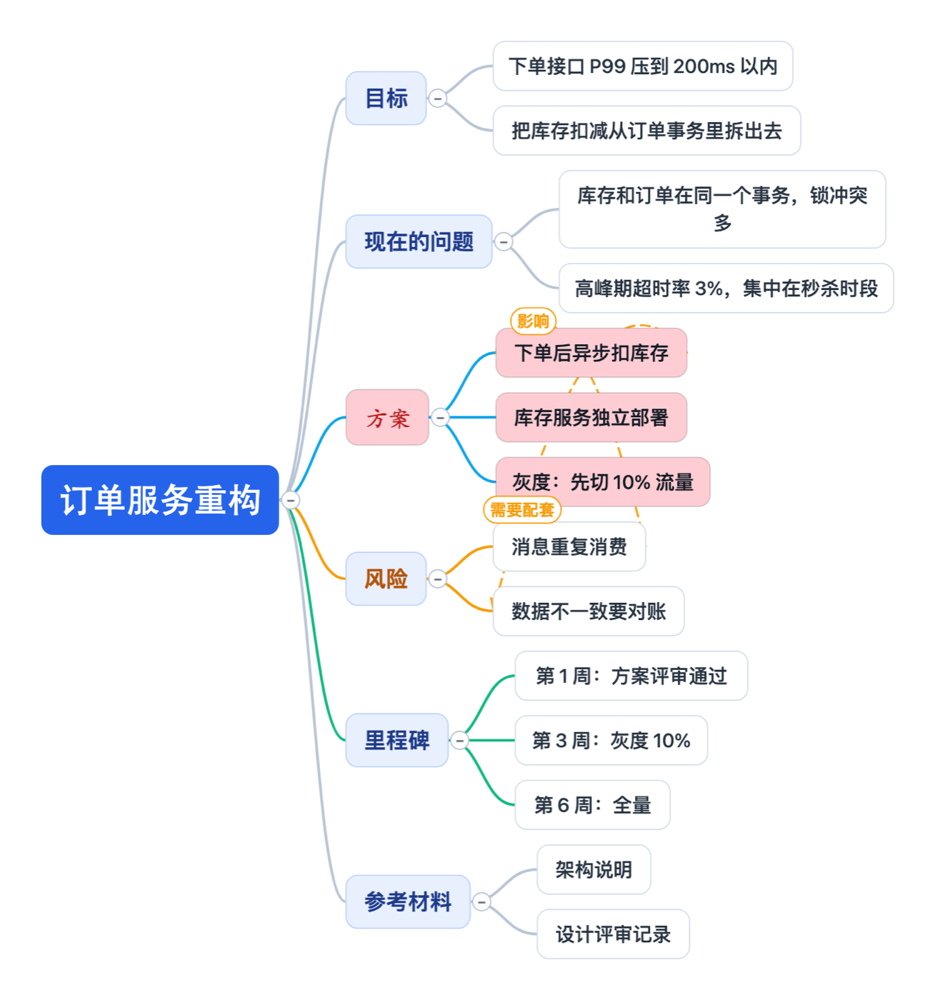
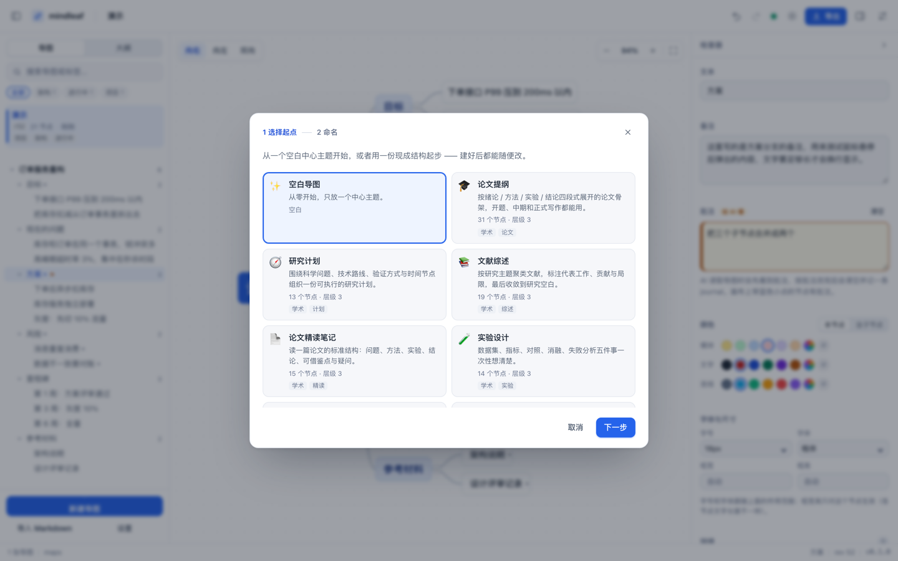
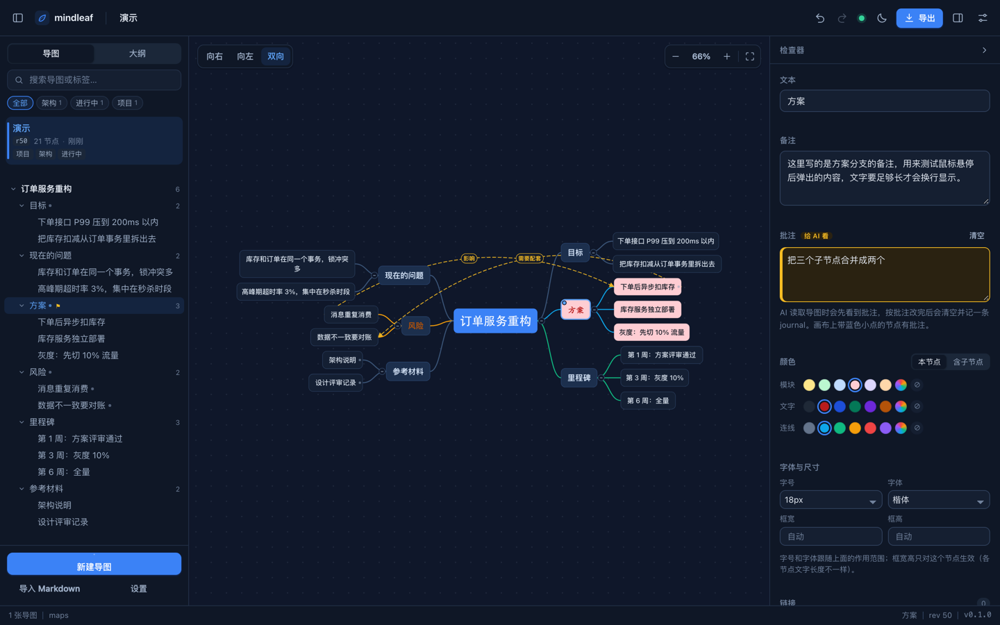
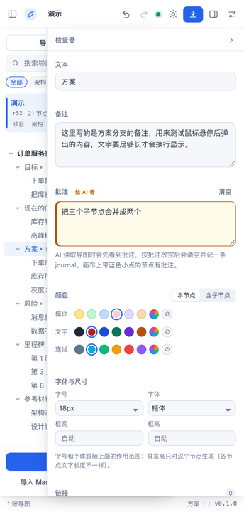

# Mindleaf

**简体中文** · [English](README.en.md)

> 你还在一个节点一个节点手搓思维导图吗？
> 你还在让 AI 吐一段 mermaid 代码，然后自己复制出来、调缩进、发现中文错位又重来一遍吗？
> 现在有 AI 了哈哈哈哈。

写论文、做项目、拆任务，事情稍微复杂一点，脑子里就是一团乱麻。这种时候我习惯先画个树，把想到的点
摊开，再往里填细节。

结果发现：想找个能跟 AI 配合的思维导图工具，居然没有。于是有了这几个月的日常 ——

- 手搓。搓到第三十个节点的时候，已经忘了第十个写的是什么。
- 让 AI 生成代码。看着挺爽，想改的时候傻眼了：调一个层级要重画整张图，中文还老错位，
  最后我成了给 AI 校对排版的那个人。
- 好不容易画完，导出一张 PNG 发出去。下次想改，手里只剩下那张 PNG。

所以用 DSH 写了这个。核心想法就一句话：

> **一张图就是一个 JSON 文件。你在网页里拖，AI 用 MCP 工具改，改的都是同一份。**

你动一个节点，它下次读的时候知道你动过哪儿（谁、什么时候、改了什么都有记录）；它改完一批，
你的浏览器会弹一句"外部修改，点一下刷新"，不会把你正在打的字冲掉。再也不用"AI 出新版本、我复制粘贴"。



# 跑起来

需要 **Node.js 20 或更新**，不用装任何依赖。两种方式挑一种：

**1. clone 完整版（想读代码 / 想改的时候）**

```bash
git clone https://github.com/SKeng-Cheng/mindleaf.git
cd mindleaf
node bin/mindleaf.mjs serve --open
```

**2. 只拉最小版（只是拿来用）**

`main` 是完整版：67 个文件，解压后 2.6 MB（zip 2.1 MB），含测试、截图和开发文档。
`lite` 是实现功能的最小包：44 个文件，解压后 437 KB（zip 146 KB），只保留跑起来需要的代码和模板。

```bash
git clone -b lite --depth 1 https://github.com/SKeng-Cheng/mindleaf.git
cd mindleaf && node bin/mindleaf.mjs serve --open
```

macOS 上还可以双击仓库里的「启动 Mindleaf.command」，它会起服务并打开浏览器。

## 服务什么时候关

默认是**网页全部关掉后自动退出**（等 20 秒，留出刷新和重连的时间），不用管它，也不会留下后台进程。
如果想让它一直挂着（比如当常驻服务，随时刷新都能打开），有两种办法：

```bash
mm serve --open --no-exit-when-closed   # 前台常驻
mm serve --detach --open                # 后台运行：关掉终端也不停，网页全关后自己退出
mm stop                                 # 手动关掉后台服务
```

`--detach` 适合双击启动或者"打开就用、用完就走"的场景：终端窗口关掉不影响服务，
浏览器里把 Mindleaf 的标签页全关了，服务会自己收尾并把状态文件清掉。

## 第一次运行

```bash
mm serve --open                              # 起网页（默认 7788，被占用会自动往后找）
mm new "项目规划" --template project-roadmap  # 新建一张图
mm export 项目规划 -f png                     # 导出
```

第一次运行会在当前目录生成三样东西：

```
当前目录/
├── mindleaf.json   # 配置：图放哪、导出放哪（第一次运行自动创建，不会进 git）
├── maps/           # 你的导图都在这儿（普通 JSON）
└── exports/        # 导出的图片和 PDF
```

**想换地方存图**：网页 设置 → 导图目录，或者 `mm config --maps-dir ~/Documents/maps`，会被记住。
（`mindleaf.json` 改了之后，AI 下次读到的也是新目录。）

# 功能

## 一、网页上直接改图

左边是图列表，中间是画布，右边是当前选中节点的属性。滚轮缩放，拖空白处平移，双击空白回到居中。

加节点不用点菜单，键盘就够了：

| 操作 | 快捷键 |
| --- | --- |
| 新建导图 | `⌘/Ctrl + N` |
| 加子节点 / 加同级节点 | `Tab` / `Enter` |
| 编辑选中的节点 | `F2`，或者双击 |
| 删节点（连子树一起） | `Delete` |
| 同级上移 / 下移 | `↑` / `↓` |
| 跳到父节点 / 第一个子节点 | `←` / `→` |
| 折叠 / 展开 | `Space` |
| 撤销 / 重做 | `⌘/Ctrl + Z` / `⇧⌘Z` |
| 换个父节点 | 直接把节点拖到目标节点上 |
| 侧栏看导图列表 / 大纲 | `⌘/Ctrl + 1` / `⌘/Ctrl + 2` |

按下 `Tab` 之后直接就能打字，不用再点输入框 —— 顺着思路一路 `Tab` `Enter` `Tab` 下去，
一张图就出来了。中间打错了 `⌘Z`。

节点可以折叠，图大了先收起来只看骨架；旁边还有历史版本，改坏能退回去。

### 节点样式

选中节点后，右侧面板从上到下是：文字、备注、颜色、字体与尺寸、链接、结构。

颜色的三种：**模块**（节点底色）、**文字**（字色）、**连线**（连到该节点的那条线，子节点会自动继承）。
每行有 6 个预设色、一个自定义取色盘和一个清除按钮。

字号、字体、框的大小在同一块里：

| 项 | 说明 |
| --- | --- |
| 字号 | 自动，或 12 / 13 / 14 / 15 / 16 / 18 / 20 / 22 / 24 / 28 / 32 |
| 字体 | 系统默认、黑体、宋体、楷体、等宽、西文衬线 —— 都是系统自带字体，不下载任何东西 |
| 框宽 / 框高 | 留空自动；填了就是固定宽度 / 最小高度（文字撑不下时会自动变高，不会压掉字） |

颜色区右上角有「**本节点 / 含子节点**」切换：

- **本节点**：只改选中的这个
- **含子节点**：连同所有子孙一起改（颜色、字号、字体支持；框宽高只对单节点生效，因为各节点文字长度不一样）

### 侧栏字号与栏宽

左右两栏都可以按自己的习惯调，调完记住，下次打开还是这样：

- **字号**：设置 → 界面 → 侧栏字号，有小 / 标准 / 大 / 特大四档，只影响左右两栏（画布里的字号由节点自己的样式决定）
- **栏宽**：把鼠标放在两栏和画布之间的分隔线上，拖动就行；双击分隔线恢复这一栏的默认宽度
- 设置 → 界面 里也有「恢复默认栏宽」按钮，并显示当前两栏各是多少像素
- 分隔线被选中时（Tab 到它）也能用 `←` `→` 微调



## 二、和 AI 一起改同一张图

这是写这个工具最主要的原因。

接上 MCP 之后，AI 那边有 19 个工具，典型用法是：

```
read_map  →  apply_ops  →  export_map
拿到节点id    一次改好几处    出图
```

大部分 AI 画图工具的流程是：你说需求 → AI 吐一段代码或者一张图 → 你复制过去 → 想改再从头来一遍。
改到第三轮的时候，AI 已经不知道现状是什么了。这里不一样：AI 每次都从文件里读最新的结构，
你上午手动调过的顺序、加过的备注、改过的标题，它下午接手的时候都看得见。

它还能区分是谁改的：每次修改都记了 `user` / `agent` / `cli` 和时间摘要，AI 用 `recent_changes`
能拿到"人类刚动了哪几个节点"。

你也不用担心被覆盖：AI 改完之后，你开着的网页会提示"外部修改"，你手头没事就自动合并，正在打字就等你点一下。

## 三、批注：直接告诉 AI 这里怎么改

看图的时候经常会冒出一句"这块应该拆成两个"。以前得切到 AI 对话框里描述半天"第 3 章下面那个节点"，
现在直接在节点上写：

选中节点 → 右侧面板「备注」下面就是「批注」，写成你想让 AI 做什么，比如"把这三个子节点合并成两个"。
带批注的节点左上角有个**蓝色小点**，大纲里也会标一个 ⚑，一眼能看出哪里还没处理。
AI 改完把批注清掉，蓝点就自动消失了。

AI 那边是这样接的：

- `read_map` 的顶部会先提示"有 N 条批注等你处理"，outline 里用 `⚑ 批注:` 标出原文
- `list_annotations` 一次列出所有图里待处理的批注（带节点 id）
- AI 按批注改完之后，把该节点的 `annotation` 置空，并在备注里写一句改了什么

```bash
mm annotations                 # 看所有待处理的批注
mm set 项目规划 第三章 --annotation "拆成两节：方法总览、具体实现"
mm set 项目规划 第三章 --annotation ""     # 处理完清掉
```

批注会跟着文件走，所以换电脑、换 AI 都还在。

## 四、悬停看备注

画布上只能看到节点标题，详细信息（备注）藏在右侧面板里。鼠标在节点上停一会儿，备注就直接浮在鼠标旁边：



- 停留多久由你定：设置 → 界面 → 备注悬停提示，可以选关闭 / 0.5 / 1 / 1.5 / 2 / 3 秒（默认 1.5 秒）
- 没有备注的节点不弹，弹出来的是备注原文（保留换行）
- 字号跟左右两栏一致，你把侧栏字号调大了，它也跟着变大
- 拖动、缩放、平移的时候不会弹，免得挡手

## 五、标签：给图分类，找起来快

图一多就乱。所以每张图可以打几个标签，侧栏顶部会列出所有标签和各自的数量，点一下只看那一类。

标签在图列表里就能改（鼠标移到条目上，点标签图标），新建的时候也能直接填。
搜索框同时搜标题、文件名和标签，记住一个词就能找到。

```bash
mm tag 项目规划 --add 项目,进行中     # 加标签
mm tag 项目规划 --remove 进行中       # 去掉某个
mm tag 项目规划                       # 看当前标签
mm list --tag 项目                    # 只看带这个标签的图
```

## 六、大纲侧栏：大图也能看清结构

画布适合想细节，但要通览整棵树的层级，还是列表更直观。侧栏切到「大纲」，就是一棵缩进的树：



- 点某一行，画布上对应的节点会被选中并滚到视野中间；
- 有子节点的行前面有个箭头，能就地折叠，不用回画布操作；
- 带备注的节点后面有个小圆点；
- 顶部搜索框能在大纲里找节点，命中会自动展开到那一层。

## 七、节点能挂链接：文件、网页、代码

| 类型 | 写法 | 点开之后 |
| --- | --- | --- |
| 文件 | `docs/architecture.md`（相对路径） | 右侧抽屉里直接预览内容 |
| 网址 | `https://example.com` | 浏览器新标签打开 |
| 代码 | `src/order/service.ts#L120-L180` | 带行号预览，并高亮指定行 |

相对路径从 `mindleaf.json` 的 `workspaceDir` 开始算，默认是项目目录。预览窗口旁边还有
"在 Finder 中显示"（Windows 是资源管理器），省得自己去翻文件夹。



## 八、十个开箱能用的模板

新建的时候可以直接选模板。论文提纲、研究计划、文献综述这些有，做项目、开会、排周计划也有：

| 模板 | 用来干嘛 |
| --- | --- |
| 论文提纲 | 绪论 / 方法 / 实验 / 结论的骨架 |
| 研究计划 | 问题、技术路线、验证方式、时间表 |
| 文献综述 | 按主题把文献归类，收敛到空白点 |
| 论文精读笔记 | 读一篇论文时的固定提纲 |
| 实验设计 | 数据集、指标、对照、消融、失败分析 |
| 项目路线图 | 里程碑、交付物、风险 |
| 会议纪要 | 议题、结论、待办、负责人 |
| 周计划 | 目标、任务、阻塞、复盘 |
| SWOT 分析 | 四个象限加策略 |
| 知识地图 | 学习路径和待读清单 |



模板就是 `templates/` 下的 Markdown 文件，标题层级对应树的层级，列表项变成节点备注。
想加自己的，丢一个 `.md` 进去就行。

## 九、导出：PNG / JPG / PDF / SVG / Markdown / JSON / HTML

```bash
mm export 项目规划 -f pdf              # 默认写到 exports/
mm export 项目规划 -f png --scale 2 -o ~/Desktop/项目规划.png
```


| 格式 | 适合什么场景 |
| --- | --- |
| `png` / `jpg` | 发给别人、贴进 PPT（浏览器直接生成，2 倍分辨率） |
| `pdf` | 打印、附在文档里。有 Chrome 或 Edge 时是矢量文字，中文能选中复制 |
| `svg` | 插网页、插 LaTeX/PPT，放大不糊，节点还带超链接 |
| `md` | 转成大纲交给别的工具，还能再导回来 |
| `json` | 备份、迁移 |
| `html` | 单个文件，双击就能看，样式全内联 |

`mm doctor` 会告诉你能用哪些能力。一个都没有也不影响正常用 —— 网页里导 PNG/JPG 是浏览器自己画的。

## 十、深色、窄屏、还有一堆小地方

<p align="center">
  
  
</p>

左边是深色主题配"向两边长"的布局；右边是把窗口拉窄到手机尺寸，侧栏和属性栏会收成浮层，画布占满整个宽度。

布局有三种：向右长、向左长、两边各一半。切换之后会自动缩放居中。

# 命令行

不想开浏览器的时候，或者想写进脚本里的时候。所有命令都能加 `--project <目录>` 指定项目；
不加就向上找 `mindleaf.json`。

| 命令 | 作用 |
| --- | --- |
| `mm serve [--port 7788] [--open]` | 起网页（网页全关后自动退出） |
| `mm serve --detach [--open]` | 后台运行：关掉终端也不停，网页全关后退出 |
| `mm stop` | 关闭后台服务 |
| `mm open [导图]` | 起网页并打开某张图 |
| `mm list [--tag 标签]` | 列出导图，可按标签过滤 |
| `mm show <导图> [--json\|--md]` | 看导图（默认带节点 id） |
| `mm new <标题> [--template 模板] [--tags a,b]` | 新建导图 |
| `mm add <导图> <文字> [--parent 节点]` | 加节点，父节点写 id 或文字 |
| `mm set <导图> <节点> ...` | 改节点：`--text` `--note` `--annotation` `--color` `--text-color` `--line-color` `--font-size` `--font` `--width` `--height` `--link` `--parent` `--subtree` |
| `mm rm <导图> <节点>` | 删除节点（含子树） |
| `mm mv <导图> <节点> <新父节点>` | 移动节点 |
| `mm edge <导图> <起点> <终点> [--label]` | 加跨分支关联线 |
| `mm tag <导图> [--add a,b] [--remove c] [--set x,y] [--clear]` | 管理标签 |
| `mm annotations [导图]` | 列出待处理的批注 |
| `mm import <导图\|new> <文件.md>` | 从 Markdown 导入 |
| `mm export <导图> -f png\|jpg\|pdf\|svg\|md\|json\|html` | 导出 |
| `mm log <导图> [--since rev]` | 看谁在什么时候改了什么 |
| `mm rollback <导图> --rev 3` | 回滚到某个版本 |
| `mm templates` / `mm fonts` | 列出模板 / 可用字体 |
| `mm doctor` | 检查环境与导出能力 |
| `mm config [--maps-dir 路径]` | 查看 / 修改项目配置 |

几个例子：

```bash
mm new "毕业论文" --template thesis-outline --tags 论文,进行中
mm add 毕业论文 "3.1 问题定义" --parent "第 3 章"
mm set 毕业论文 "第 3 章" --color "#fecdd3" --font-size 18 --subtree   # 整枝换配色和字号
mm set 毕业论文 "第 3 章" --width 220 --height 90                      # 单个节点定框尺寸
mm export 毕业论文 -f png --scale 2
mm import new 综述大纲.md
mm log 毕业论文
```

上面的 `mm` 是简写，实际就是项目目录里的 `node bin/mindleaf.mjs`；想直接敲 `mm` 可以加个别名：
`alias mm="node $(pwd)/bin/mindleaf.mjs"`。`mm <命令> --help` 看完整参数。

# 接入 AI

MCP 走标准 stdio 协议，DSH、Codex、Claude Code、Claude Desktop 都能接：

```bash
node bin/mindleaf.mjs mcp --project "/path/to/项目"
```

AI 那边的 19 个工具：`list_maps` `list_tags` `list_fonts` `list_templates` `create_map` `read_map`
`add_node` `update_node` `remove_node` `move_node` `apply_ops` `add_edge` `update_map` `list_annotations` `export_map`
`import_markdown` `recent_changes` `open_in_browser` `doctor`。

配置可以自动写，也可以只打印出来自己贴：

```bash
node integrations/install.mjs --check        # 看看哪家接过了
node integrations/install.mjs                # 打印所有配置片段，不动文件
node integrations/install.mjs --apply        # 真写进去（先备份）
node integrations/install.mjs --target dsh   # 生成 DSH 的插件包
```

## DeepSeek Harness

```bash
node integrations/install.mjs --target dsh
```

然后在 Plugins → Add plugin 里选 `integrations/.rendered/dsh/mindleaf-mcp`。新开一个会话，
工具名会带 `mindleaf__` 前缀，比如 `mindleaf__read_map`。

## Codex CLI

改 `~/.codex/config.toml`：

```toml
[mcp_servers.mindleaf]
command = "/absolute/path/to/node"
args = ["/path/to/mindleaf/bin/mindleaf.mjs", "mcp", "--project", "/path/to/项目"]
cwd = "/path/to/项目"
startup_timeout_sec = 20
tool_timeout_sec = 120

[mcp_servers.mindleaf.env]
PATH = "/absolute/path/to/node-dir:/usr/local/bin:/usr/bin:/bin"
```

`codex mcp add` 也能加，只是它没有 `cwd` 参数，还是直接编辑 TOML 省事。

## Claude Code

放在项目根的 `.mcp.json`，第一次用要在 `/mcp` 里点一下同意：

```json
{
  "mcpServers": {
    "mindleaf": {
      "type": "stdio",
      "command": "/absolute/path/to/node",
      "args": ["/path/to/mindleaf/bin/mindleaf.mjs", "mcp", "--project", "/path/to/项目"],
      "env": { "PATH": "/absolute/path/to/node-dir:/usr/local/bin:/usr/bin:/bin" }
    }
  }
}
```

## Claude Desktop

改 `~/Library/Application Support/Claude/claude_desktop_config.json`，原来的 `preferences` 别动，
只加一个 `mcpServers`。它不会热加载，改完要完全退出再启动。

## 两个坑，提前说

一是从图标点开的 GUI 程序，PATH 里通常没有 nvm 装的 node，工作目录也常常是 `/`。所以配置里一律写
node 的绝对路径，并且用 `--project` 明确告诉它项目在哪。

二是 stdout 只能出 JSON-RPC，服务器里任何一句 `console.log` 都会让宿主直接断开。日志都走 stderr。

给 AI 看的说明单独写在 [AGENTS.md](AGENTS.md) 里。Codex 会自动读它，Claude Code 读的 `CLAUDE.md`
是指向它的。

# 数据与备份

```
项目目录/
├── mindleaf.json          # 项目配置（第一次运行自动生成，不进 git）
├── maps/
│   ├── 项目规划.mindmap.json
│   └── .history/<slug>/   # 最近 30 个版本快照
└── exports/
```

- **导图是普通 JSON**，想进 git 管版本，把 `.gitignore` 里 `/maps/` 那行删掉即可。
- 每次写入 `rev` 加一，并记一条 journal（谁、什么时候、改了什么），`mm log` 可查。
- 改坏了用 `mm rollback <导图> --rev N` 退回，网页里也能看历史版本。
- 换电脑：把 `mindleaf.json` + `maps/` 一起拷走就行，没有数据库、没有隐藏状态。

## 文件长什么样

```jsonc
{
  "format": "mindmap", "schemaVersion": 1, "rev": 2,
  "title": "项目规划",
  "tags": ["项目", "进行中"],
  "settings": { "layout": "right", "theme": "light" },
  "nodes": [
    { "id": "root", "parent": null, "text": "项目规划", "order": 0, "collapsed": false, "note": "", "links": [] },
    { "id": "n_1", "parent": "root", "text": "第一步：梳理现状", "order": 0,
      "color": "#fecdd3", "textColor": "#b91c1c", "lineColor": "#0ea5e9",
      "fontSize": 18, "font": "kai", "boxWidth": 220,
      "links": [{ "kind": "file", "target": "docs/architecture.md", "label": "架构说明" }] }
  ],
  "edges": [{ "id": "e_1", "from": "n_1", "to": "n_2", "label": "关联" }],
  "journal": [{ "rev": 2, "at": "…", "by": "agent", "action": "ops", "summary": "新增 3 个节点" }]
}
```

简单说：节点平铺在一个数组里，用 `parent` 指上去；`rev` 每写一次加一，`journal` 记下每次改动；
`tags` 是图的标签。完整例子可以看 [examples/demo.mindmap.json](examples/demo.mindmap.json)。

# 项目结构

零依赖：只用 Node 标准库，网页是原生 JS 没有构建步骤，AI 那边走 MCP stdio。
`mindleaf.json` 和 `maps/` 是本机配置和数据，`.gitignore` 里已经挡住，不会跟着仓库走。

```bash
bin/mindleaf.mjs        入口：serve / mcp / 各种子命令
src/core/               文档模型、操作、Markdown 互转、布局、SVG 渲染
src/export/             导出（图片、PDF、各格式）
src/server/             HTTP 服务与本地存储
src/mcp/                MCP 服务器
web/                    网页界面（index.html / app.js / style.css）
templates/              内置模板（Markdown，可自己加）
tests/                  测试
integrations/           各家 AI 的接入配置与一键脚本
examples/               示例导图
```

# 常见问题

**端口被占用了？** `mm serve --port 7800`；不加端口它会自动往后找空号。

**`command not found: mm`？** 这个命令不是全局安装的，按上面加个 alias，或者直接用 `node bin/mindleaf.mjs`。

**导出的 PDF 里中文选不中？** 说明本机没有 Chrome / Edge，PDF 退化成了整页图片（能看能打印，
但文字不可选）。装个 Chromium 系浏览器再导一次就是矢量的。

**网页里改了，另一个 agent 什么时候能看到？** 立刻。每次写入都会 `rev + 1` 并实时通知。

**两个人能同时改吗？** 不能实时协同。范围是"同一台机器、同一个目录"，多人协作请用 git。

**只想清掉工具、保留导图？** 删掉代码目录即可，`maps/` 里是独立 JSON 文件。

**怎么卸载？** 删掉 clone 下来的目录即可。导图数据在 `maps/`，不会被动。

# 已知的问题

- 矢量 PDF 依赖本机装了 Chrome 或 Edge。没有的话中文 PDF 是图片，能用但文字选不中。
- 一千个节点以上的大图，第一次渲染会有点卡。几百个节点的图没什么感觉。
- 协作范围就是"同一台机器、同一个目录"。多人同时改请用 git。
- 只用过 Chrome 和 Edge，Safari 和 Firefox 没试过。

# 系统兼容性

这个工具我只在 macOS 上用过。Linux 和 Windows 一次都没跑过，那边会不会有问题我说不好。

代码里留了各平台的路径（Chrome / Edge 的安装位置、用 `xdg-open` 和 `explorer` 开浏览器），
但都没实际跑过。你在别的系统上跑起来，或者踩到坑，开个 issue 说一声就行。

# License

[MIT](LICENSE) © 2026 SKeng-Cheng

---

写得比较糙，但自己每天都在用。如果你也老是要画这种树，希望能省一点时间。
如果想要什么功能，可以给自己的agent许愿，或者向作者许愿。
